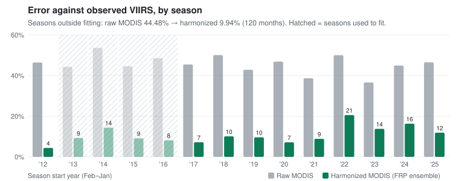
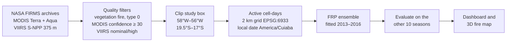

# Beyond the Hotspots

**One burning-activity record for Brazil's Pantanal, built from two generations of NASA fire satellites.**

NASA Space Apps Challenge 2026 · [Harmonization of MODIS and VIIRS Hot Spots](https://www.spaceappschallenge.org/2026/challenges/modis-and-viirs-hot-spots/) · Team **The Kernel**

**[Open the dashboard](https://beyond-the-hotspots.vercel.app)** · **[Open the 3D fire map](https://beyond-the-hotspots-globe.vercel.app)** · [3D map source](https://github.com/iamghaid/beyond-the-hotspots-globe)

---

## The problem

NASA has watched fires from space with **MODIS** (Terra and Aqua, since 2000, ~1 km pixels) and, since 2012, with **VIIRS** on Suomi NPP (375 m pixels). VIIRS sees small, weak fires that MODIS misses. In our study area it records far more burning activity than MODIS for the same months.

That gap breaks long-term analysis. Put MODIS years next to VIIRS years and the record "jumps" in 2012 because the sensor changed, not because the fires did. Our goal was to put MODIS on the VIIRS scale, prove how well that works, and give people one calendar where they can explore burning activity and spot unusual months.

## Result

Across **120 months that the model never saw**, MODIS error against observed VIIRS fell from **44.48% to 9.94%**.



| Test (weighted absolute error vs observed VIIRS) | Raw MODIS | Single factor ×1.84 | **FRP ensemble (ours)** |
|---|---:|---:|---:|
| Outside fitting: 10 seasons, 120 months | 44.48% | 11.51% | **9.94%** |
| Later seasons 2018–2025: 96 months | 44.18% | 12.75% | **10.79%** |
| All 168 months, fitting included | 44.85% | 11.41% | **9.88%** |

Stricter checks, where the whole method is refitted every time:

| Robustness check | FRP ensemble |
|---|---:|
| Leave one season out (14 folds) | 10.93% |
| Train on past seasons only, predict the next one | 11.69% |
| Time-reversed: train on later seasons, predict earlier ones | 7.5% – 8.3% |

Under every test the error stays near 8–12%, against about 44% without harmonization. The time-reversed check matters for going back before 2012, where only MODIS exists.

We also tested other model variants and **NASA POWER** monthly cloud and aerosol data. None passed our pre-set replacement rule (better in every held-out group and in at least 6 of 10 seasons), so the FRP ensemble stays. Monthly regional averages can't capture the clouds or smoke present at each satellite overpass.

## What you can do on the dashboard

- **Calendar, Monthly or Yearly.** Monthly shows one year as 12 tiles. Yearly shows every month from 2003 to 2026 in one grid, so fire seasons and extreme years (2019, 2020, 2023) stand out at a glance.
- **Amount or "vs. usual".** Color tiles by burning activity (five quantile steps, darker = more), or by how each month compares with the same month in other years. That is the challenge's "unusual periods" question.
- **Switch the series.** Observed MODIS, observed VIIRS, harmonized MODIS, or the calendar view (observed MODIS before February 2012, harmonized MODIS after).
- **Month detail.** All three values side by side, plus a plain-language line such as "21× the usual November".
- **Proof chart.** Three series over time, and an **error-by-season** view of the result above.
- **Downloads.** CSV of all months, all weeks, the selected seasons or year, or the error table.
- **3D fire map.** A separate globe that shows where each sensor detected burning, cell by cell, including a MODIS / VIIRS / both comparison.

## Method



1. **Activity unit.** An *active cell-day* is a 2 × 2 km grid cell with at least one qualifying detection on one local day. MODIS is the union of Terra and Aqua, so a cell seen by both counts once. This removes the effect of multiple pixels and overpasses from the same fire.
2. **Why fire intensity.** VIIRS adds small, low-intensity fires. Intense fires are seen by both sensors. A single multiplier therefore over-corrects the biggest fire months. We split MODIS cell-days into three fire radiative power (FRP) bands, using the maximum FRP per cell-day: under 10 MW, 10–50 MW and 50 MW or more.
3. **Model.**
   `harmonized = 0.5 × (1.84 × MODIS) + 0.5 × (1.142 × low + 2.425 × medium + 0.952 × high)`
   The 1.84 multiplier minimizes weekly absolute error. The three FRP coefficients minimize monthly absolute error (linear programming, bounded 0–6). Both are fitted only on February 2013 – January 2017.
4. **Evaluation.** Weighted absolute error = Σ |estimate − VIIRS| ÷ Σ VIIRS, so busy months count more than near-empty ones. Seasons run February to January.
5. **Unusual months.** "Usual" is the median of the same calendar month within the same series: observed MODIS for 2003–2025, harmonized MODIS for 2012–2025.

## Limitations

- The scores measure **agreement with VIIRS**, not with fires on the ground. We have no ground-truth fire records.
- The test periods were inspected while the method was developed. The results are retrospective, not a fresh independent validation. The robustness checks above are our answer to that.
- Harmonization corrects **totals**. It cannot recover the location of a small fire MODIS never detected.
- Results are validated for the full study box. Smaller subareas are not validated.
- Satellite observation coverage (clouds, outages) is unverified. VIIRS hotspot type is provisional. Before February 2012 the calendar shows observed MODIS.

## Reproduce the numbers

The `analysis/` folder rebuilds every number above from compact monthly and weekly files in about a second:

```bash
cd analysis
pip install numpy scipy
python check_results.py
```

The full pipeline from raw FIRMS archives is `analysis/harmonization_frp_ensemble.ipynb`. It needs the FIRMS archive downloads for the study box, which are not stored in this repository.

## Repository

```
index.html, app.js, styles.css   Dashboard (static site, no build step, no framework)
monthly.json                     276 months, Feb 2003 – Jan 2026: MODIS, VIIRS, harmonized MODIS
weekly.json                      Weekly values Feb 2012 – Jan 2026 (CSV download)
kernel-logo.webp, favicon.svg    Assets
docs/error-by-season.svg         Result figure used in this README
analysis/
  harmonization_frp_ensemble.ipynb   Full pipeline from FIRMS archives
  check_results.py                   Reproduces the results and robustness tables
  monthly_overlap.csv                168 overlap months with MODIS FRP bands
  weekly_overlap.csv                 Weekly MODIS and VIIRS, used to fit the 1.84 factor
  calibration_model.json             Coefficients, fit period, sources, validation
  per_season_metrics.csv             Error per season and method
  model_comparison.csv               Methods compared by test group
```

## Run locally

```bash
python3 -m http.server 8000
# open http://localhost:8000
```

## Data and credits

- Fire detections: [NASA FIRMS](https://firms.modaps.eosdis.nasa.gov/download/) archive, MODIS Collection 6/6.1 (Terra, Aqua) and VIIRS S-NPP 375 m.
- Weather test: [NASA POWER](https://power.larc.nasa.gov/) monthly cloud amount and aerosol optical depth (CERES SYN1deg).
- 3D map: Esri World Imagery, Mapzen/AWS terrain tiles, OpenStreetMap Nominatim search, MapLibre GL JS.

## Team The Kernel

Gheid Abdulkarim (team owner) · Idris Jan Mohammad · Suhaib AbduRahiman · Mohammed Al Attas · Wejdan Salem Bamakhish

Saudi Arabia · NASA Space Apps Challenge 2026
