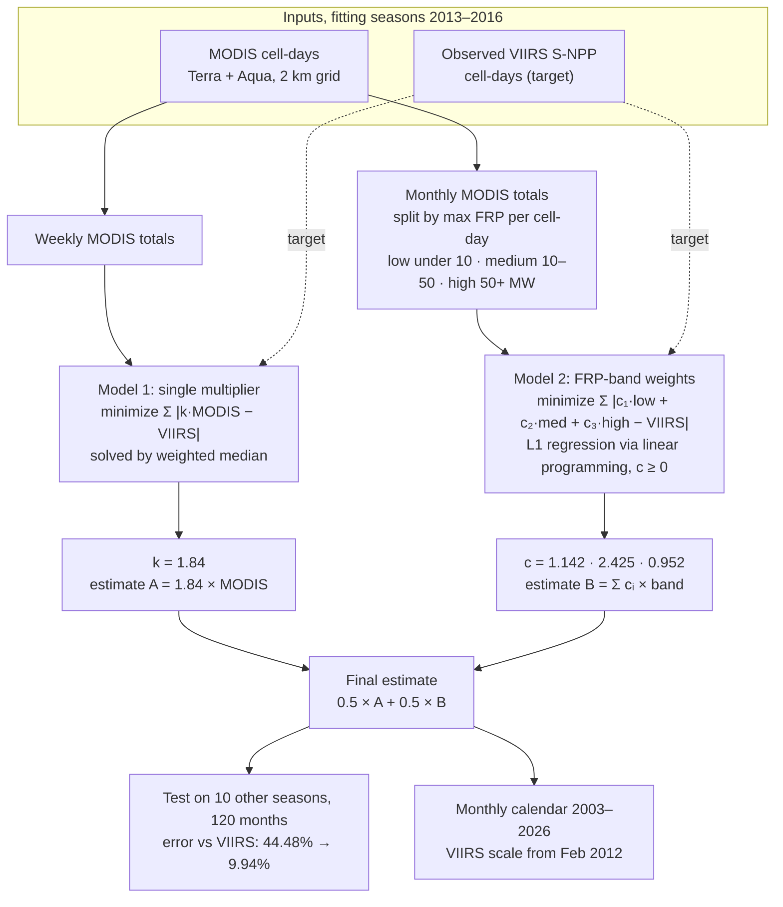
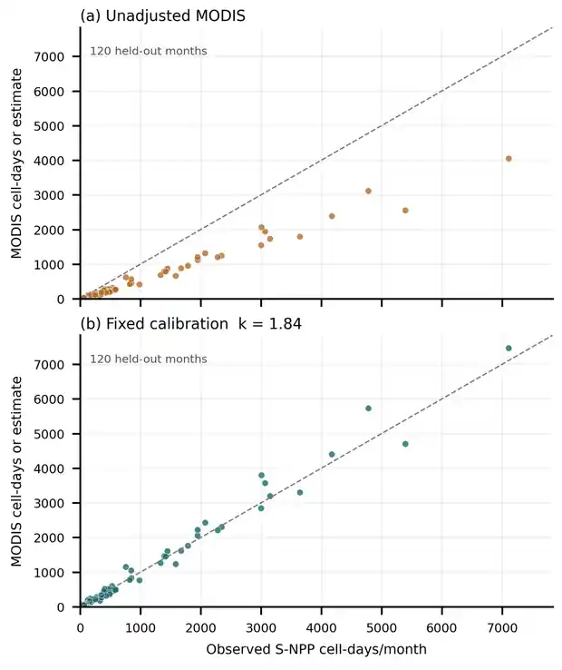
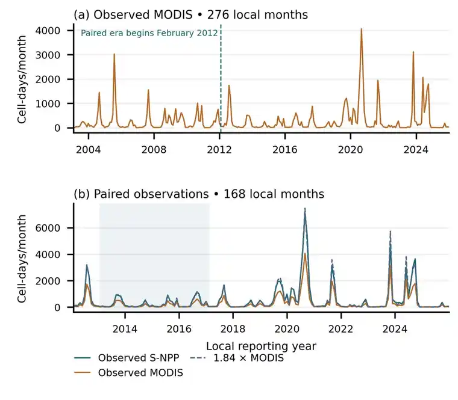
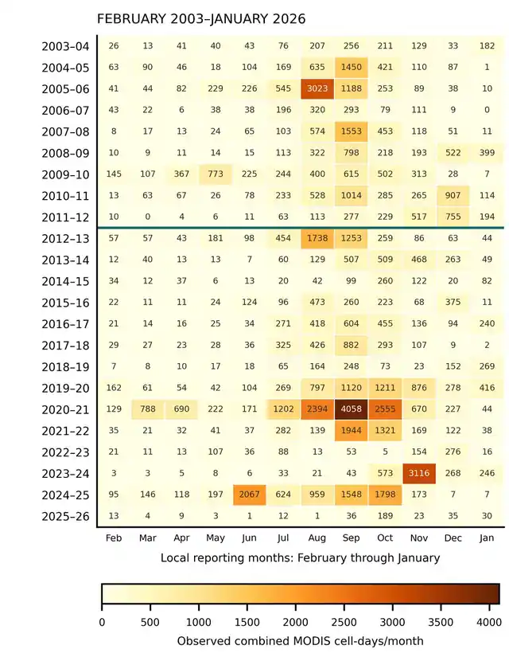
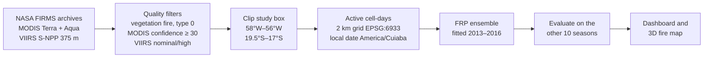
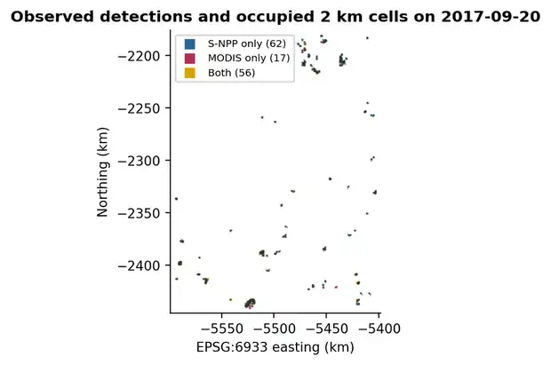
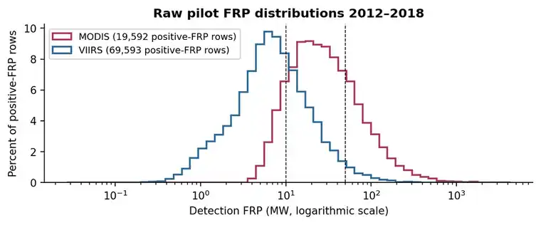

<p align="center">
  
</p>

<h1 align="center">Beyond the Hotspots</h1>

<p align="center"><strong>One burning-activity record for Brazil's Pantanal, built from two generations of NASA fire satellites.</strong></p>

<p align="center">
  <a href="https://www.spaceappschallenge.org/2026/challenges/modis-and-viirs-hot-spots/"></a>
  <a href="https://www.spaceappschallenge.org/2026/challenges/modis-and-viirs-hot-spots/"></a>
  
</p>

<p align="center">
  <a href="https://beyond-the-hotspots.vercel.app"><strong>Open the dashboard</strong></a> ·
  <a href="https://beyond-the-hotspots-globe.vercel.app"><strong>Open the 3D fire map</strong></a> ·
  <a href="https://github.com/iamghaid/beyond-the-hotspots-globe">3D map source</a>
</p>

---

## The problem

NASA has watched fires from space with **MODIS** (Terra and Aqua, since 2000, ~1 km pixels) and, since 2012, with **VIIRS** on Suomi NPP (375 m pixels). VIIRS sees small, weak fires that MODIS misses. In our study area it records far more burning activity than MODIS for the same months.

That gap breaks long-term analysis. Put MODIS years next to VIIRS years and the record "jumps" in 2012 because the sensor changed, not because the fires did. Our goal was to put MODIS on the VIIRS scale, prove how well that works, and give people one calendar where they can explore burning activity and spot unusual months.

## Our algorithm in brief

> We fit two models against observed S-NPP VIIRS cell-day counts by minimizing absolute error on seasons 2013–2016: one applies a single multiplier (1.84) to weekly MODIS counts, and the other applies separate non-negative weights to monthly MODIS counts in three fire radiative power bands (<10, 10–50, ≥50 MW). The final estimate is the 50/50 average of the two predictions.



| Step | Algorithm | Output |
|---|---|---|
| 1. Single multiplier | **Weighted median** of weekly VIIRS ÷ MODIS ratios, the exact least-absolute-error solution for one factor | k = 1.84 |
| 2. FRP-band model | **L1 regression** (least absolute deviations) with non-negative coefficients, solved by **linear programming** (SciPy) | 1.142 low · 2.425 medium · 0.952 high |
| 3. Final estimate | **Ensemble average**, 50/50 of steps 1 and 2 | VIIRS-equivalent cell-days |

Why L1 and not ordinary least squares: absolute error is not dominated by a few extreme months such as September 2020, so one huge fire season cannot pull the coefficients toward itself. The model has four numbers in total, which keeps it easy to explain and hard to overfit.

**Full specification:** [docs/ALGORITHM.md](docs/ALGORITHM.md) gives every formula, the filtering rules, a worked example for February 2012, and a refit on all 14 paired seasons.

## Result

Across **120 months that the model never saw**, MODIS error against observed VIIRS fell from **44.48% to 9.94%**.


| Test (weighted absolute error vs observed VIIRS) | Raw MODIS | Single factor ×1.84 | **FRP ensemble (ours)** |
|---|---:|---:|---:|
| Outside fitting: 10 seasons, 120 months | 44.48% | 11.51% | **9.94%** |
| Outside fitting: 512 complete weeks | 45.03% | 16.04% | **14.81%** |
| Later seasons 2018–2025: 96 months | 44.18% | 12.75% | **10.79%** |
| All 168 months, fitting included | 44.85% | 11.41% | **9.88%** |

Calibrated bias outside fitting is −1.42% for the ensemble, so it neither systematically over- nor under-estimates VIIRS.

<p align="center">
  
</p>
<p align="center"><sub><b>From our research report, Fig. 3.</b> The same 120 months outside fitting: unadjusted MODIS, the 1.84 scalar and the final ensemble against observed VIIRS. Dashed line = equal totals.</sub></p>

Stricter checks, where the whole method is refitted every time:

| Robustness check | FRP ensemble |
|---|---:|
| Leave one season out (14 folds), monthly | 10.93% |
| Leave one season out (14 folds), complete weeks | 15.46% |
| Train on past seasons only, predict the next one | 11.69% |
| Time-reversed: train on later seasons, predict earlier ones | 7.5% – 8.3% |

Under every test the error stays near 8–12%, against about 44% without harmonization. The time-reversed check matters for going back before 2012, where only MODIS exists.

<p align="center">
  
</p>
<p align="center"><sub><b>From our research report, Fig. 2.</b> (a) Observed MODIS for all 276 months, 2003–2026. (b) The 168 paired months: the FRP ensemble (orange) tracks observed VIIRS (blue) through the 2020 megafire and the 2023–2024 peaks. Shaded = fitting seasons.</sub></p>

We also tested other model variants and **NASA POWER** monthly cloud and aerosol data. None passed our pre-set replacement rule (better in every held-out group and in at least 6 of 10 seasons), so the FRP ensemble stays. Monthly regional averages can't capture the clouds or smoke present at each satellite overpass.

## The full record, 2003–2026

<p align="center">
  
</p>
<p align="center"><sub><b>From our research report, Fig. 6.</b> Observed MODIS cell-days for all 23 fire seasons, one definition throughout. The line marks February 2012, when VIIRS observations begin. The busiest month is September 2020 (4,058 MODIS cell-days, 7,108 VIIRS).</sub></p>

## What you can do on the dashboard

- **Calendar, Monthly or Yearly.** Monthly shows one year as 12 tiles. Yearly shows every month from 2003 to 2026 in one grid, so fire seasons and extreme years (2019, 2020, 2023) stand out at a glance.
- **Amount or "vs. usual".** Color tiles by burning activity (five quantile steps, darker = more), or by how each month compares with the same month in other years. That is the challenge's "unusual periods" question.
- **Switch the series.** Observed MODIS, observed VIIRS, harmonized MODIS, or the calendar view (observed MODIS before February 2012, harmonized MODIS after).
- **Month detail.** All three values side by side, plus a plain-language line such as "21× the usual November".
- **Proof chart.** Three series over time, and an **error-by-season** view of the result above.
- **Downloads.** CSV of all months, all weeks, the selected seasons or year, or the error table.
- **3D fire map.** A separate globe that shows where each sensor detected burning, cell by cell, including a MODIS / VIIRS / both comparison.

## Method



1. **Filtering.** Validate the FIRMS schema, remove exact duplicate rows, convert UTC acquisition time (padded to four digits) to the local `America/Cuiaba` date, keep detections inside the box (boundary included) with hotspot type 0, MODIS confidence ≥ 30 and VIIRS confidence nominal or high.
2. **Activity unit.** An *active cell-day* is a 2 × 2 km grid cell with at least one qualifying detection on one local day. MODIS is the union of Terra and Aqua, so a cell seen by both counts once. This removes the effect of multiple pixels and overpasses from the same fire.
<p align="center">
  
</p>
<p align="center"><sub><b>From our research report, Fig. 4.</b> One real day, 20 September 2017, from the raw FIRMS files: 2 km cells seen by VIIRS only (62), MODIS only (17) and both (56), 41% overlap. The sensors rarely see exactly the same cells, so we harmonize daily totals, not individual points.</sub></p>

3. **Why fire intensity.** VIIRS adds small, low-intensity fires. Intense fires are seen by both sensors. A single multiplier therefore over-corrects the biggest fire months. We split MODIS cell-days into three fire radiative power (FRP) bands, using the maximum FRP per cell-day: under 10 MW, 10–50 MW and 50 MW or more.

<p align="center">
  
</p>
<p align="center"><sub><b>From our research report, Fig. 5.</b> Fire radiative power of every detection in the 2012–2018 raw pilot (19,592 MODIS, 69,593 VIIRS rows). VIIRS detects many weak fires below 10 MW that MODIS rarely records. Dashed lines = our 10 and 50 MW band limits.</sub></p>
4. **Model.**
   `harmonized = 0.5 × (1.84 × MODIS) + 0.5 × (1.142 × low + 2.425 × medium + 0.952 × high)`
   The 1.84 multiplier minimizes weekly absolute error over 206 complete weeks; its solution is the MODIS-weighted median of weekly VIIRS/MODIS ratios. The three FRP coefficients minimize monthly absolute error over 48 months (L1 regression solved by linear programming, bounded 0–6). Both are fitted only on February 2013 – January 2017.
5. **Worked example, February 2012** (outside fitting). MODIS saw 57 cell-days: 8 low, 39 medium, 10 high FRP.
   `1.84 × 57 = 104.88` · `1.142 × 8 + 2.425 × 39 + 0.952 × 10 = 113.22` · average **109.05**. VIIRS actually counted **104**.
6. **Evaluation.** Weighted absolute error = Σ |estimate − VIIRS| ÷ Σ VIIRS, so busy months count more than near-empty ones. Seasons run February to January.
7. **Unusual months.** "Usual" is the median of the same calendar month within the same series: observed MODIS for 2003–2025, harmonized MODIS for 2012–2025.

A second release refits the same model on all 14 paired seasons (k = 1.759; FRP weights 1.100 · 2.364 · 1.190) and gives harmonized estimates for 106 of the 108 months before 2012. The dashboard uses the 2013–2016 release above, because only that one has untouched test seasons. Details in [docs/ALGORITHM.md](docs/ALGORITHM.md).

## Limitations

- The scores measure **agreement with VIIRS**, not with fires on the ground. We have no ground-truth fire records.
- The test periods were inspected while the method was developed. The results are retrospective, not a fresh independent validation. The robustness checks above are our answer to that.
- Harmonization corrects **totals**. It cannot recover the location of a small fire MODIS never detected.
- Results are validated for the full study box. Smaller subareas are not validated.
- Satellite observation coverage (clouds, outages) is unverified. VIIRS hotspot type is provisional. Before February 2012 the calendar shows observed MODIS. Weeks with zero MODIS cell-days get a blank estimate, and quiet weeks are where the method is weakest.

## Reproduce the numbers

The `analysis/` folder rebuilds every number above from compact monthly and weekly files in about a second:

```bash
cd analysis
pip install numpy scipy
python check_results.py
```

The full pipeline from raw FIRMS archives is `analysis/harmonization_frp_ensemble.ipynb` ([open in Colab](https://colab.research.google.com/github/iamghaid/beyond-the-hotspots/blob/main/analysis/harmonization_frp_ensemble.ipynb) · [read with outputs](https://nbviewer.org/github/iamghaid/beyond-the-hotspots/blob/main/analysis/harmonization_frp_ensemble.ipynb)). The 2003–2012 MODIS years come from `analysis/modis_backfill_2003_2012.ipynb`, which uses the same filters, local dates and 2 km grid. Both need the FIRMS archive downloads for the study box, which are not stored in this repository.

**The final record in one file:** [`analysis/pantanal_monthly_2003_2026.csv`](analysis/pantanal_monthly_2003_2026.csv) lists all 276 months with observed MODIS, observed VIIRS, the FRP ensemble (from February 2012), the 1.84× scalar for every month, and the value the dashboard shows. Before February 2012 no FRP bands are available in the export, so the 1.84× column is the VIIRS-scale estimate for those years.

## Repository

```
index.html, app.js, styles.css   Dashboard (static site, no build step, no framework)
monthly.json                     276 months, Feb 2003 – Jan 2026: MODIS, VIIRS, harmonized MODIS
weekly.json                      Weekly values Feb 2012 – Jan 2026 (CSV download)
kernel-logo.webp, favicon.svg    Assets
docs/error-by-season.svg         Result figure used in this README
docs/paper-fig*.webp             Figures from our research report (Fig. 2–6)
docs/ALGORITHM.md                Full algorithm specification with formulas and a worked example
LICENSE                          MIT licence for the code
analysis/
  pantanal_monthly_2003_2026.csv     Final record: all 276 months, every series in one table
  harmonization_frp_ensemble.ipynb   Full pipeline from FIRMS archives, 2012–2026
  modis_backfill_2003_2012.ipynb     MODIS cleaning and counts, 2003–2012
  modis_backfill_monthly.csv         Monthly MODIS cell-days, Feb 2003 – Jan 2012
  check_results.py                   Reproduces the results and robustness tables
  monthly_overlap.csv                168 overlap months with MODIS FRP bands
  weekly_overlap.csv                 Weekly MODIS and VIIRS, used to fit the 1.84 factor
  calibration_model.json             Coefficients, fit period, sources, validation
  per_season_metrics.csv             Error per season and method
  model_comparison.csv               Methods compared by test group
```

## Run locally

```bash
python3 -m http.server 8000
# open http://localhost:8000
```

## Data and credits

- Fire detections: [NASA FIRMS](https://firms.modaps.eosdis.nasa.gov/download/) archive, MODIS Collection 6/6.1 (Terra, Aqua) and VIIRS S-NPP 375 m.
- Weather test: [NASA POWER](https://power.larc.nasa.gov/) monthly cloud amount and aerosol optical depth (CERES SYN1deg). This was a separate experiment; its result is reported above and in our research report, and its code is not part of this repository.
- 3D map: Esri World Imagery, Mapzen/AWS terrain tiles, OpenStreetMap Nominatim search, MapLibre GL JS.

## Licence

Code: [MIT](LICENSE). NASA FIRMS and NASA POWER data follow [NASA's open data policy](https://www.earthdata.nasa.gov/engage/open-data-services-software-policies/data-use-guidance). Map tiles and fonts keep their own providers' terms.

## Team The Kernel

Gheid Abdulkarim (team owner) · Idris Jan Mohammad · Suhaib AbduRahiman · Mohammed Al Attas · Wejdan Salem Bamakhish

Saudi Arabia · NASA Space Apps Challenge 2026
